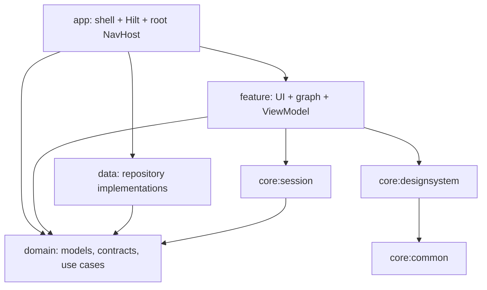

# OneSpace

Android Native · Kotlin · Jetpack Compose · Material 3 · Hilt/KSP · API 26+

Bộ khung Video, Music, News & Games với các **Gradle module độc lập**. Hiện dùng dữ liệu mẫu và mô phỏng playback/game; chưa nối media engine, backend hoặc persisted storage.

## Cấu trúc module

```text
app/                         :app — Application, MainActivity, Hilt, shell, root navigation
domain/                      :domain — Kotlin/JVM, models, contracts, use cases, session rules
  src/main/kotlin/.../domain/
    video/ music/ news/ games/ session/
data/
  video/                     :data:video — video repository implementation
  music/                     :data:music — music repository implementation
  news/                      :data:news — articles + in-memory bookmarks
  games/                     :data:games — game catalog
feature/
  home/                      :feature:home
  video/                     :feature:video
  music/                     :feature:music
  news/                      :feature:news
  games/                     :feature:games
  account/                   :feature:account — guest + settings preview
core/
  common/                    :core:common — Kotlin/JVM, reusable UI state
  designsystem/              :core:designsystem — theme, shared Compose components
  session/                   :core:session — shared UI coordinator + SavedStateHandle adapter
  media/                     :core:media — future playback adapter boundary
  network/                   :core:network — future Retrofit/OkHttp
  database/                  :core:database — future Room
  datastore/                 :core:datastore — future preferences storage
  sync/                      :core:sync — future WorkManager
docs/
  architecture.md            Architecture audit, decisions and Android reference links
```

Mỗi module có build file riêng; các module Android có manifest/namespace riêng. `core`, `data`, `feature` ở root là nhóm module, không phải package trong app. Không còn feature/domain/data/core source code dưới `app/src`.

## Ranh giới ba lớp



- **Presentation:** màn hình nhận state/callbacks; ViewModel thuộc navigation graph của feature, dùng Hilt và `StateFlow`. Feature công khai API navigation; màn hình/ViewModel là `internal`.
- **Domain:** Kotlin/JVM thuần, không Android/Compose/Hilt. Repository contracts và use cases tách khỏi implementation. SessionPolicy sở hữu quy tắc audio/background; SelectNextTrack sở hữu quy tắc queue.
- **Data:** mock repository phát catalog bằng `Flow`, bookmark dùng `MutableStateFlow` ở repository. Implementation là `internal`; app nối qua factory trả về interface domain.
- **App:** `@HiltAndroidApp`, `@AndroidEntryPoint`, Hilt `RepositoryModule`, global shell và đăng ký feature graphs. App không tạo catalog ViewModel, không giữ bookmark hoặc logic Next.
- Không có dependency feature → feature, feature → data hoặc domain → Android. Feature giao tiếp qua root navigation/callbacks và shared coordinator.

Core media/network/database/datastore/sync đã là module thật nhưng chưa nối runtime. Chưa có dependency Media3/Retrofit/Room/DataStore/WorkManager; thêm khi triển khai tương ứng. DI thủ công đã được thay bằng **Hilt + KSP thực sự**.

Đánh giá chi tiết và đối chiếu tài liệu Android: [docs/architecture.md](docs/architecture.md).

## Navigation

5 tab: Home, Video, Music, News, Games. Mỗi tab là nested graph, giữ back stack bằng `saveState / restoreState / launchSingleTop`.

```text
Home → các catalog
Video → Video detail → Float & explore → News
Music → Now Playing → Next
News → Article → Save story; catalog có bộ lọc Saved
Games → 2048 / Tic-Tac-Toe board preview → Pause / Resume
Guest → Profile → Settings
```

Feature sở hữu route/arguments và graph của mình. App nối các graph và điều hướng liên feature. Arguments chỉ truyền ID, không truyền model. Top bar và system Back dùng cùng NavController. Màn chi tiết giữ bottom bar để thử chuyển phân hệ.

Floating video và mini music player là UI của app shell, nhận title/state từ coordinator dùng chung; app không đọc catalog của feature để vẽ player.

## State và phạm vi hoạt động

| State | Owner / scope | Giới hạn hiện tại |
| --- | --- | --- |
| Catalog | Repository → use case → graph-scoped feature ViewModel | Mock bundled catalog |
| News bookmarks | Singleton mock NewsRepository → NewsViewModel | In-memory, mất khi process bị kill |
| Tab back stack, scroll, filter | Navigation + saveable Compose state | Android saved-state restoration |
| Data saver toggle | Settings destination, rememberSaveable | UI preview, chưa đổi streaming |
| Playback selection + play/pause | Một SessionCoordinator ở app shell | UI simulation, không phát media |
| Quy tắc chuyển nội dung/audio | Domain SessionPolicy | Thuần Kotlin, có unit tests |
| Game board | Game UI preview | Board tĩnh; chưa có gameplay/save game |
| Playback ID/title sau recreate | Coordinator SavedStateHandle | Không autoplay; không thay Room/DataStore |

Video tiếp tục floating khi chuyển News/Home/game mute, pause khi sang Music. Phát nhạc sẽ pause video; phát video sẽ pause nhạc. Rời game sẽ pause; mở board gọi resume. Activity ON_STOP pause video/game, giữ state nhạc. **Không có âm thanh, video stream, notification hay background service thật trong build này.**

## Build và kiểm tra

Mở root project bằng Android Studio, Sync Gradle rồi Run `app` trên API 26+. Giữ SDK/JDK cấu hình sẵn của project; Gradle daemon dùng JDK 25, bytecode các module target JVM 11.

```powershell
.\gradlew.bat projects
.\gradlew.bat :app:assembleDebug :domain:test :core:session:testDebugUnitTest :app:testDebugUnitTest
.\gradlew.bat :app:assembleDebugAndroidTest
.\gradlew.bat :app:lintDebug
```

APK: `app/build/outputs/apk/debug/app-debug.apk`.

Unit tests nghiệp vụ ở `domain/src/test`; test saved-state adapter ở `core/session/src/test`. `NavigationSmokeTest` ở app kiểm tra floating video, bookmark khi đổi tab và mở lại Now Playing từ mini-player. Cần emulator/thiết bị để chạy:

```powershell
.\gradlew.bat :app:connectedDebugAndroidTest
```

Máy dựng skeleton chưa có thiết bị/AVD; compile UI test không thay thế việc chạy test trên thiết bị.

## Triển khai tiếp

1. Chốt API và dữ liệu; thay factory/binding mock, thêm data sources/DTO/entity/mappers trong data modules.
2. Tích hợp core hạ tầng đúng nơi được dùng, thêm retry/error handling thực tế.
3. Media3 video controller dùng chung detail/floating, MediaSessionService cho music, Audio Focus và notification. Service/controller sở hữu playback, không để Activity/ViewModel giữ player.
4. Room/DataStore cho tiến độ, bookmarks/preferences, game state và session checkpoints. Streaming cache khác downloaded content.
5. Gameplay thực, offline/lifecycle/process-death tests và đo tài nguyên trên thiết bị.
